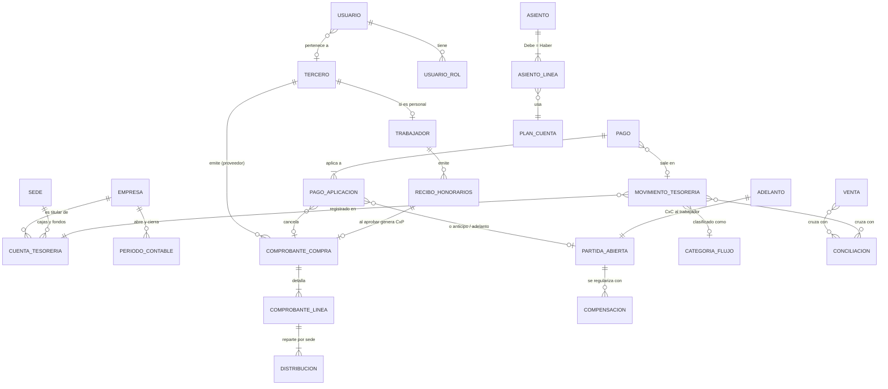

# Plataforma PET TIME — Etapa 0: diagnóstico y diseño

**Versión 0.1 · 13/10/2026 · Estado: PROPUESTA, pendiente de confirmación de la Dirección**

Este documento responde al paso 0 de la especificación: diagnóstico de la app actual, modelo de base de datos único, mapa de pantallas, menú unificado, plan de migración de los datos existentes y preguntas pendientes. **No se ha escrito código todavía.**

---

## 0. Resumen

1. La app actual (`ordalis-max/pettime-app`, desplegada en Vercel) ya usa el stack recomendado: **Next.js 16 + PostgreSQL en Supabase + Prisma**, con buena base de seguridad. **Se conserva el stack y se evoluciona el mismo repositorio**; no se reescribe desde cero.
2. Se reutilizan: autenticación con sesiones en servidor, bloqueo por intentos, almacenamiento privado con URLs firmadas, bitácora, patrón de servicios con permisos en servidor, exportación Excel/PDF y el formulario de gastos.
3. Se rehacen: roles (de 5 roles fijos a roles y permisos configurables por empresa/sede/módulo/acción), catálogo de sedes (hoy mezcla sedes y áreas), catálogo de bancos (hoy mezcla entidades, medios de pago y cajas) y el modelo de gasto/pago, que pasa a alimentar un **motor contable de partida doble**.
4. Los datos actuales (usuarios, gastos, pagos, comprobantes, bitácora) **se conservan con sus mismos IDs y códigos** (GAS-000001, PAG-000001) mediante migraciones aditivas y un script de traslado verificable.
5. Hay **dos riesgos que corregir antes de empezar** (ver 1.4): las publicaciones de prueba (Preview) de Vercel pueden migrar la base de producción, y el repositorio `PRUEBA` es público.

---

## 1. Diagnóstico de la app actual

### 1.1 Qué existe

| Aspecto | Situación actual |
|---|---|
| Stack | Next.js 16 (App Router) · TypeScript · Tailwind 4 · Prisma 6 · PostgreSQL (Supabase) · Auth.js v5 (credenciales) · Supabase Storage · exceljs · jsPDF · Recharts · Zod |
| Despliegue | Vercel (región São Paulo `gru1`). En cada build de Vercel se aplican migraciones y el seed |
| Login | Usuario + clave (bcrypt), cambio obligatorio en el primer ingreso, bloqueo de 15 min tras 5 intentos, límite por IP, sesión en servidor (8 h máx., 30 min de inactividad), revocación inmediata |
| Roles | Enum fijo: ADMIN, GERENCIA (valida), TESORERIA, REGISTRADOR (por sede), CONSULTA. Un rol por usuario |
| Modelo | Usuario, UsuarioSede, Sesion, Sede, TipoGasto, TipoDocumento, Banco, Proveedor, CuentaProveedor, Gasto, ValidacionHistorial, Pago, PagoDetalle, Adjunto, Bitacora (15 tablas) |
| `/gastos/nuevo` | Fecha de emisión, sede/área, tipo de gasto, cantidad, tipo de documento, serie, número, RUC (autocompleta proveedor y sus cuentas), razón social, moneda, monto total, cálculo de IGV 18 %, descripción, banco/cuenta/CCI del proveedor, banco desde el que se pagará, observaciones, comprobantes adjuntos (foto desde el celular) |
| Flujo | Gasto *Por revisar → Validado / Observado*; pago *Pendiente → Parcial → Pagado*; un pago puede cubrir varios gastos del mismo proveedor y moneda; anulación con motivo (nunca se borra) |
| Archivos | Bucket privado `comprobantes`; subida directa del navegador con URL firmada; verificación del tipo real del archivo (PDF/JPG/PNG, 10 MB); descarga con URL firmada de 60 s y control de sede |
| Reportes | Dashboard + 7 reportes exportables a Excel y PDF |
| Seguridad | Permisos verificados en el servidor y filtrado por sede; CSP, HSTS, anti-iframe; RLS activado en Supabase sin políticas (bloquea la API pública) |
| Pruebas | `scripts/test-flujo.ts`: prueba integral de permisos y flujo contra el servidor en ejecución |

### 1.2 Qué se reutiliza

- **Todo el stack** y la estructura `servicios → acciones → pantallas`.
- **Autenticación** (`src/server/autenticacion.ts`, `src/lib/sesion.ts`): se amplía para usuario = documento, consentimiento Ley 29733, acceso de solo lectura para cesados y varios roles por persona.
- **Almacenamiento privado** (`src/server/almacenamiento.ts`): se generaliza a todos los módulos, con clasificación de archivos (normal, personal, salud) y verificación de permisos por dueño.
- **Bitácora**: se agregan las acciones VER, DESCARGAR, APROBAR, DENEGAR, REABRIR y el agente de usuario.
- **Utilidades**: manejo de montos en céntimos, fechas en `America/Lima`, correlativos, validaciones Zod, exportación Excel/PDF.
- **Formulario de gastos**: se conserva su experiencia (autocompletar RUC, IGV, foto desde el celular) y se le agregan campos (ver pantalla A.2).
- **Prueba integral** `test-flujo.ts`: se mantiene y se amplía.

### 1.3 Qué se rehace o amplía

| Hoy | Cambio | Motivo |
|---|---|---|
| Enum `Rol` (1 rol por usuario) | Tablas de roles, permisos y asignaciones con alcance por empresa y sede | Varios roles por persona; permisos configurables por módulo y acción |
| `Sede` mezcla sedes y áreas (Operaciones, Gerencia, Logística, Marketing) | Se separa en **Sede**, **Unidad administrativa** y **Centro de costos** | Distinguir empresa, sede, unidad y centro de costos |
| `Banco` mezcla entidades (BCP), medios (Yape, Plin, Efectivo) y cajas | **Entidad financiera**, **Medio de pago** y **Cuenta de tesorería** (cuentas bancarias de cada empresa, cajas y fondos) | Saber de qué cuenta de qué empresa sale cada pago |
| `Gasto` sin empresa, centro de costos ni devengo | **Comprobante de compra** con empresa, devengo, distribución, retenciones y cuenta contable (misma tabla, ampliada) | Contabilidad, ER y multiempresa |
| `Pago` con banco genérico | **Pago de tesorería** con cuenta de origen, fecha bancaria, categoría de flujo y aplicaciones a facturas, anticipos, RH, planilla, etc. | Flujo de caja y conciliación |
| Sin contabilidad | **Motor contable** con asientos balanceados garantizados por la base de datos | Principio 1 |
| Usuario sin persona | **Tercero** (persona o empresa) y **Trabajador**; el usuario se vincula a la persona | Un solo registro de proveedores y personas |
| Colores genéricos (#0f766e) | Turquesa #027f7a, fucsia #ee2a8a, celeste #dceff8, gris #6c6e6c, MADE TOMMY / Nunito | Identidad de marca |

### 1.4 Riesgos detectados (a corregir antes de construir)

1. **Las publicaciones Preview de Vercel pueden migrar la base de producción.** `scripts/build.mjs` aplica `prisma migrate deploy` cuando existe `VERCEL`, y esa variable también existe en los builds de Preview (cada rama que se sube). Si las variables de entorno de Vercel están configuradas para *todos los entornos* (lo habitual), subir una rama con migraciones nuevas **modificaría la base de producción antes de aprobar el cambio**. Corrección: migrar solo cuando `VERCEL_ENV=production` y usar un **segundo proyecto de Supabase (pruebas)** para Preview. Esta corrección irá en el primer commit, antes de cualquier migración.
2. **El repositorio `PRUEBA` es público.** No deben subirse ahí los Excel financieros, bases de trabajadores ni el Brand Book. Recomiendo hacerlo privado y trabajar el código en `pettime-app` (privado y ya conectado a Vercel).
3. **Capacidad del plan de Supabase.** Libros de ventas de decenas de miles de filas por mes, extractos de 12 cuentas y PDF de boletas y recibos crecen rápido. El plan gratuito tiene límites bajos de base de datos y de archivos; probablemente se necesite el plan Pro.
4. **Datos actuales incompletos para el nuevo modelo**: los gastos no indican empresa y los pagos solo dicen "BCP" o "BBVA" (no de qué empresa). Se resuelve con reglas de asignación y una pantalla de revisión (ver sección 4).

---

## 2. Decisiones de arquitectura

| Tema | Decisión |
|---|---|
| Repositorio | Evolucionar `ordalis-max/pettime-app` (privado, conectado a Vercel). *Requiere tu autorización* |
| Base de datos | PostgreSQL en Supabase (la actual). Migraciones versionadas con Prisma; las reglas críticas (balance de asientos, periodos cerrados, no borrar) se implementan además como **triggers de PostgreSQL**, para que ni un error de programación pueda romperlas |
| Login | Uno solo para todos. Usuario = número de documento; el `admin` actual se conserva como SUPERADMIN; los usuarios actuales siguen entrando con su usuario hasta vincularse a su ficha de trabajador |
| Permisos | Matriz rol × módulo × acción en base de datos, con alcance por empresa y sede. Verificación en cada servicio y en cada ruta de archivo (respuesta 403) |
| Motor contable | Servicio único `contabilizar(operación)` que aplica **reglas configurables** (asociación de cuentas) y genera asientos. Las pantallas de sede y del colaborador nunca muestran asientos |
| Trabajos en segundo plano | Tabla `trabajo` (cola con reintentos y progreso) + endpoint protegido que procesa por bloques. Se dispara cada minuto con `pg_cron` de Supabase (funciona con cualquier plan de Vercel) y también al encolar. Se usa para importaciones, conciliación, ZIP masivos, correos, cierres y tareas programadas |
| Archivos grandes | El Excel/CSV se lee **en el navegador por bloques** (Web Worker, con barra de progreso) y se envía al servidor en lotes de ~2 000 filas, que el servidor **vuelve a validar**. El archivo original se guarda en el almacenamiento privado para auditoría. Así se evitan los límites de tamaño y tiempo de Vercel |
| Correo | Capa única de envío con cola, reintentos y registro de cada correo. Proveedor **pendiente de tu respuesta** |
| PDF | En el servidor (jsPDF, ya instalado; pdf-lib para hojas de evidencia y huella SHA-256 del formato firmado) |
| Excel | exceljs (ya instalado) para exportaciones con tus formatos |
| Pruebas | Vitest + PostgreSQL embebido (PGlite, ya en el proyecto) para probar triggers y motor contable sin servidor externo; `test-flujo` para permisos de punta a punta; GitHub Actions para correrlas en cada cambio |
| Monedas | Soles como moneda base. Cada importe guarda moneda original, tipo de cambio y equivalente en soles. Tabla diaria de tipo de cambio (carga manual o importada) |
| Fechas | Fechas de negocio como `DATE`; eventos como `timestamptz`; todo se muestra en `America/Lima` y `dd/mm/aaaa` |
| Tipografía | Nunito (autoalojada) desde ya; MADE TOMMY en cuanto tengamos los archivos y su licencia web |

---

## 3. Modelo de datos único

### 3.1 Principios

- **Una sola base y un solo catálogo** de empresas, sedes, centros de costo, terceros (proveedores, clientes y personas), cuentas de tesorería y periodos para todos los módulos.
- **Nada contabilizado se borra**: se anula o se revierte. Los registros con historial se desactivan. Un trigger impide el `DELETE` en las tablas con historial.
- **Toda tabla financiera lleva `empresa_id`**; toda tabla operativa lleva `sede_id` cuando aplica, para filtrar permisos.
- **Montos** `numeric(14,2)`; tipo de cambio `numeric(12,6)`; porcentajes `numeric(7,4)`.
- **Auditoría**: `creado_por`, `creado_en`, `actualizado_en` en todas las tablas, más la bitácora de acciones.

### 3.2 Diagrama del núcleo



Idea central: **toda operación nace en un formulario simple**, el servicio de su módulo la guarda y llama al motor contable, que genera el asiento. Los reportes leen de una sola fuente:

- **Flujo de caja real** → movimientos de tesorería, por **fecha bancaria** y **categoría de flujo**.
- **Estado de Resultados** → líneas de asiento de cuentas de ingreso y gasto, por **mes de devengo**, sede y centro de costos.
- **Balance** → saldos de todas las cuentas a una fecha contable.
- **Partidas abiertas** (anticipos, entregas a rendir, transitorias, adelantos al personal, pagos por identificar, CxC) → una sola tabla con saldo y antigüedad, que alimenta las bandejas y la sección de cuentas compensables.

### 3.3 Tablas por dominio

#### A. Organización (compartido por todos los módulos)

| Tabla | Para qué | Campos clave |
|---|---|---|
| `empresa` | Las 4 empresas legales | ruc, razón social, nombre corto, dirección, representante, logo, activo |
| `sede` | Chorrillos, Surco, Miraflores, Jesús María, San Borja, Activaciones, Comercial, Corporativo, Oficina central | código, nombre, tipo (CLÍNICA / ACTIVACIÓN / COMERCIAL / CORPORATIVO / OFICINA), prefijo de solicitudes (CH, SU, MI, JM, SB), ¿centro de resultados?, orden, activo |
| `unidad_administrativa` | Unidades del organigrama | nombre, padre, activo |
| `centro_costo` | Administración, Operaciones, Marketing, Logística, Área Médica, Grooming/Baños, Pet Shop, **proyectos** (ej. Proyecto Jesús María) | código, nombre, tipo (ÁREA / PROYECTO / ESPECIAL), sede (si aplica), presupuesto, ¿capitalizable?, vigencia |
| `cargo` | Cargos del personal | nombre, unidad, centro de costos por defecto, **clasificación de costo** (MÉDICO / GROOMING / OPERATIVO / ADMINISTRATIVO), que decide la línea del ER |
| `tipo_cambio` | Tipo de cambio diario | fecha, compra, venta, fuente |
| `tipo_documento` | Comprobantes y documentos de identidad | código SUNAT (01 factura, 03 boleta, 02 RH, 12 ticket, 14 recibo de servicio, 00 sin comprobante…), clase |
| `lista_valor` | Listas editables genéricas | tipo de lista, código, nombre, orden, activo (tipos de reembolso, tipos de solicitud, prioridades, motivos de cese, tipos de inasistencia, de permiso, de amonestación, áreas de activos…) |
| `parametro` | Configuración | clave, valor (JSON), empresa opcional, vigencia (tasa de retención, tope, plazo de descargo, días de solo lectura, % de gasto administrativo aceptado…) |

#### B. Personas, usuarios y seguridad

| Tabla | Para qué | Campos clave |
|---|---|---|
| `tercero` | **Registro único** de proveedores, clientes y personas (los trabajadores RH figuran también como proveedores con su RUC) | tipo de persona, tipo y número de documento, RUC, razón social o apellidos y nombres, correo, teléfono, dirección, ¿proveedor?, ¿cliente?, activo. Únicos: (tipo doc, número) y RUC. **Absorbe la tabla `Proveedor` actual** |
| `tercero_cuenta_bancaria` | Cuentas de proveedores y trabajadores | entidad, número, CCI (cifrado), moneda, titular, verificada. **Absorbe `CuentaProveedor`** |
| `usuario` | Acceso | username (documento o el usuario actual), tercero, hash de clave, debe cambiar clave, intentos, bloqueado hasta, estado (ACTIVO / SOLO_LECTURA / BLOQUEADO / INACTIVO), solo lectura hasta, último ingreso. **Tabla actual ampliada** |
| `sesion` | Sesiones del servidor | **Sin cambios** |
| `rol`, `permiso`, `rol_permiso` | Roles y matriz módulo × acción | código de permiso `modulo.accion` (ver, crear, editar, aprobar, anular, exportar, descargar, configurar, reabrir) |
| `usuario_rol` | Roles de cada persona con alcance | usuario, rol, empresa (vacío = todas), sede (vacío = todas). Una persona puede tener varios |
| `consentimiento_version`, `consentimiento_aceptacion` | Ley N.° 29733 | texto versionado; usuario, versión, fecha, IP |
| `bitacora` | Auditoría | **Actual, ampliada** con VER, DESCARGAR, APROBAR, DENEGAR, REABRIR y agente de usuario |

#### C. Contabilidad

| Tabla | Para qué | Campos clave |
|---|---|---|
| `plan_cuenta` | PCGE + auxiliares + clasificación gerencial | código, descripción, naturaleza, nivel, padre, ¿permite movimiento?, ¿permite asiento manual?, centro de costos (obligatorio / opcional / no), ¿requiere tercero?, ¿compensable?, moneda, estado, vigencia |
| `reporte_estructura`, `reporte_linea` | Filas del **Flujo de caja**, **ER** y **Balance**, editables | reporte, versión; línea: padre, código, nombre, tipo (título / detalle / subtotal / fórmula), fórmula, orden, signo, % de alerta (ej. gastos administrativos > 20 %) |
| `cuenta_linea_reporte` | **Ubicación de cada cuenta** en cada reporte, con vigencia | cuenta, reporte, línea, vigente desde/hasta. Reubicar una cuenta crea una vigencia nueva y no altera los reportes históricos |
| `categoria_flujo` | TIPO → DESGLOSE de tus hojas de bancos | padre (TIPO), nombre (DESGLOSE), línea del flujo, sentido (ingreso/salida) |
| `regla_asociacion` | **Asociación de cuentas**: medio de pago / concepto / proveedor / categoría → cuenta + categoría de flujo + centro de costos | prioridad, condiciones, resultado, vigencia |
| `periodo_contable` | Por empresa y mes | estado (ABIERTO / EN REVISIÓN / CERRADO), cerrado por, fecha |
| `periodo_evento` | Cambios de estado y reaperturas | de, a, usuario, **motivo obligatorio** |
| `asiento` | Cabecera | empresa, número correlativo por empresa y periodo, fecha contable, origen (GASTO, PAGO, TRANSFERENCIA, VENTA, PLANILLA, RH, ADELANTO, DEPRECIACIÓN, AJUSTE, APERTURA, REVERSIÓN…), id de origen, glosa, estado (BORRADOR / CONTABILIZADO / ANULADO), asiento que revierte, aprobado por |
| `asiento_linea` | Detalle | cuenta, **debe**, **haber** (soles), debe/haber en moneda extranjera, tercero, sede, centro de costos, **mes de devengo**, **fecha bancaria**, categoría de flujo, cuenta de tesorería, documento de referencia, ¿intercompañía? |
| `distribucion_plantilla`, `distribucion_plantilla_detalle` | Reglas de reparto entre sedes | nombre, criterio; sede, centro de costos, %. Precargadas: **Salarios administrativos** 25/25/25/12.5/12.5 y **Otros gastos administrativos** 20 % × 5 sedes |
| `impuesto_config` | IGV, detracciones, retenciones, percepciones, renta de 4.ª | tipo, código, tasa, tope, vigencia, cuentas. *Se validan contigo antes de automatizar* |
| `presupuesto`, `presupuesto_linea` | Presupuesto mensual | empresa, año, versión; sede, centro de costos, cuenta o línea del ER, mes, monto |
| `cierre_checklist` | Checklist de cierre | empresa, periodo, ítem, estado (automático o manual), verificado por, evidencia |

#### D. Compras, gastos y cuentas por pagar

| Tabla | Para qué | Campos clave |
|---|---|---|
| `comprobante_compra` | **Evolución de `Gasto`** (mismo id y código GAS-) | empresa, sede, centro de costos, proveedor (tercero), tipo de documento, serie, número, fecha de emisión, fecha de vencimiento, **mes de devengo**, moneda, tipo de cambio, base imponible, IGV, no gravado, total, detracción (código, tasa, monto, constancia), retención, percepción, condición (contado / crédito), tipo de gasto (visible para la sede), descripción, **estado** (REGISTRADO / OBSERVADO / APROBADO / ANULADO), **estado de pago** (PENDIENTE / PROGRAMADO / PARCIAL / PAGADO), pagado, saldo, origen (sede, recurrente, pago directo, importación, RR. HH.), asiento |
| `comprobante_linea` | Cuenta contable por línea (normalmente una) | cuenta de gasto o activo, descripción, monto, categoría de flujo por defecto |
| `comprobante_distribucion` | Reparto por sede | línea, sede, centro de costos, %, monto. **Debe sumar 100 %** (lo verifica la base de datos) |
| `validacion_historial` | Historial de aprobación | **Actual, sin cambios** |
| `gasto_recurrente` | Alquileres, servicios, internet, sistema veterinario… | proveedor, empresa, sede, cuenta, plantilla de distribución, monto, día de generación, frecuencia, vigencia, último generado |
| `partida_abierta` | **Una sola tabla** para todo lo que queda "por regularizar" | tipo (ANTICIPO_PROVEEDOR, ENTREGA_A_RENDIR, TRANSITORIA_PAGO_MASIVO, ADELANTO_PERSONAL, PAGO_POR_IDENTIFICAR, CXC_CLIENTE, CXC_CONVENIO, CXC_SEDE, PRÉSTAMO), empresa, tercero, cuenta contable, monto original, aplicado, **saldo**, fecha de origen, responsable, estado (ABIERTA / CERRADA / DEVUELTA). Antigüedad 0–15, 16–30, 31–60 y +60 días calculada |
| `compensacion` | Lo que regulariza cada partida | partida, documento (factura, pago, cuota, devolución), monto, asiento |

#### E. Tesorería, bancos y cajas

| Tabla | Para qué | Campos clave |
|---|---|---|
| `entidad_financiera` | BCP, BBVA, Interbank, Scotiabank… | **Absorbe parte de `Banco`** |
| `medio_pago` | Transferencia, depósito, efectivo, Yape, Plin, QR, POS/tarjeta, Culqi, Niubiz… | nombre, requiere conciliación por lote, comisión por defecto |
| `cuenta_tesoreria` | Las 12 cuentas bancarias + Efectivo + Depósito sede + cajas y fondos por sede | empresa, tipo (BANCO / CAJA / FONDO_ROTATORIO / EFECTIVO / DEPÓSITO_SEDE), entidad, nombre corto (BCP TORRES…), número, CCI, moneda, sede, cuenta contable (10x), saldo inicial y fecha, plantilla de importación, responsable, estado (ACTIVA / OBSERVADA / INACTIVA). Al crearla quedan disponibles sus pantallas de movimientos, importación, saldos y conciliación |
| `movimiento_tesoreria` | **Cada fila de tu hoja de bancos** | cuenta, fecha de operación (bancaria), descripción del banco, importe (+/−), moneda, tipo de cambio, N.° de operación, **código normalizado** (solo dígitos, sin ceros a la izquierda), concepto (INGRESO / SALIDA / TRANSFERENCIA INTERNA), N.° de solicitud de pago, clasificación (categoría de flujo TIPO+DESGLOSE, sede/CECO, **mes de devengo**, cuenta contable, proveedor, documento), estado de clasificación (SIN CLASIFICAR / SUGERIDO / CLASIFICADO), estado de conciliación, validación de venta (CRUZADO / SIN DATOS DE VENTA / NO ESTÁ EN LIBRO DE VENTAS), movimiento espejo (transferencias), lote de importación, asiento, huella antiduplicado. El saldo acumulado se calcula |
| `saldo_extracto` | Saldo informado por el banco | cuenta, fecha, saldo. Si *saldo inicial + ingresos − salidas ≠ saldo del banco*, la cuenta queda **OBSERVADA** |
| `pago` | **Evolución de `Pago`** (mismo id y código PAG-) | tipo de obligación (FACTURA, ANTICIPO, PLANILLA, RH, ADELANTO, PRÉSTAMO, IMPUESTO, DEVOLUCIÓN A CLIENTE, OTRO), empresa, sede, centro de costos, cuenta de origen, **fecha bancaria**, importe, moneda, N.° de operación, categoría de flujo, cuenta de resultados o balance, **mes de imputación** (solo meses abiertos), estado (SOLICITADO / APROBADO / PROGRAMADO / EJECUTADO / ANULADO), fecha programada, aprobaciones, movimiento bancario vinculado, asiento |
| `pago_aplicacion` | **Evolución de `PagoDetalle`**: a qué se aplica cada pago | pago, comprobante o partida abierta o cuota o reembolso, monto |
| `nivel_aprobacion` | Aprobación por monto | empresa, monto desde/hasta, rol aprobador, número de aprobaciones |
| `transferencia` | Entre cuentas propias o entre empresas | cuenta de origen y destino, fecha, importe, tipo de cambio, **¿intercompañía?** (se elimina en el consolidado), los dos movimientos espejo, asiento |
| `pago_masivo` | Salida total contra transitoria | movimiento de salida, total, regularizado, saldo pendiente (usa `partida_abierta`) |
| `reembolso_cliente` | **CONTROL REEMBOLSOS** | código N001…, mes, fecha de solicitud, sede, tipo (lista editable), monto, cliente, responsable, estado (PENDIENTE / PAGADO / OBSERVADO / ANULADO), fecha de pago, pago, días transcurridos (calculado) |
| `caja_dia`, `caja_movimiento` | **CONTROL DE CAJAS** por sede | caja, fecha, inicio de caja, ingresos, adelantos, egresos, saldo final, arqueo físico, diferencia, estado (CUADRA / DESCUADRE), comentario, cerrado por; líneas con tipo, monto, trabajador (si es adelanto), comprobante |
| `reposicion_fondo` | Reposición de fondos rotatorios | fondo, comprobantes de sustento, monto, pago |

#### F. Ventas, importaciones y conciliación

| Tabla | Para qué | Campos clave |
|---|---|---|
| `plantilla_importacion` | Un formato por medio (extracto BCP/BBVA/Interbank, POS Niubiz/Vendemás, Yape, Plin, QR, libro de ventas) | columnas, fila de encabezado, formato de fecha y monto, separador decimal, columna de N.° de operación, cuenta asociada, reglas, tolerancia de días y de monto |
| `lote_importacion` | Cada archivo cargado | plantilla, archivo original, huella del archivo, estado (SUBIDO / VALIDADO / CONFIRMADO / REVERTIDO / ERROR), filas leídas, aceptadas, rechazadas, totales por medio de pago, saldo inicial/final validado, progreso, usuario, motivo de reversión |
| `lote_fila` | Filas en revisión (vista previa) | lote, número de fila, datos originales, datos normalizados, errores, estado |
| `venta` | **LIBRO DE VENTAS** | empresa, sede, ID del sistema, fecha y hora, descripción, N.° de operación, código normalizado, medio de pago, entrada, COD.B, banco, fecha banco, texto, documento de referencia, tipo de movimiento, cliente, registrado por, lote, estado de conciliación |
| `liquidacion_pos` | Abonos de tarjetas por lote | procesador, fecha, ventas del día, comisión, IGV de comisión, neto, movimiento bancario. La comisión va a gastos financieros |
| `conciliacion`, `conciliacion_item` | Cruces | tipo (1-1, 1-n, n-1, lote POS), método (AUTOMÁTICO / MANUAL), regla, diferencia, usuario; ítems: movimiento, venta, comprobante, monto |
| `regla_clasificacion` | Autoclasificación por texto del banco o proveedor (ITF, comisiones, portes, mantenimiento…) y reglas **aprendidas** | patrón, cuenta, proveedor, resultado (categoría, CECO, sede, cuenta contable), prioridad, origen (MANUAL / APRENDIDA), aciertos |
| `equivalencia` | Normalización del histórico ("GERERENCIA" → GERENCIA, "PRVEEDORES" → PROVEEDORES…) | lista (TIPO / DESGLOSE / CECO / PROVEEDOR), texto original, valor destino, estado (CONFIRMADA / DUDOSA), confianza |

#### G. Activos fijos y proyectos

| Tabla | Para qué | Campos clave |
|---|---|---|
| `activo` | **BASE ACTIVOS** | código automático por área (AM-001…), área, categoría, familia, descripción, marca/modelo/serie, cantidad, ubicación, estado, responsable, sede, fecha de adquisición, sustento, comprobante, proveedor, valor, clasificación (ACTIVO / GASTO), meses de depreciación, inicio y fin, ¿remodelación? |
| `activo_distribucion` | Reparto entre sedes | sede, área, % |
| `activo_depreciacion` | Devengo mensual (valor ÷ meses) | activo, mes, monto, asiento. Va a la línea "Adquisición & depreciación" (o "Amortización de remodelación") de la sede y área |
| `activo_movimiento` | Bajas y traslados | tipo, fecha, de/a sede, motivo |

Los **proyectos** (ej. Proyecto Jesús María) son centros de costo de tipo PROYECTO con presupuesto; al cerrarlos se pueden capitalizar como activo de remodelación y amortizar (ej. 24 meses).

#### H. CxC y solicitudes de sedes

| Tabla | Para qué | Campos clave |
|---|---|---|
| `solicitud_sede` | **SEGUIMIENTO DE SOLICITUDES DE SEDES** | código SOL-0001, fecha, mes, sede, correlativo por sede (CH-001…), solicitado por, fecha de venta, tipo, motivo, detalle, monto, ¿requiere solución?, responsable, prioridad, fecha límite, estado, fecha de cierre, días abierto (calculado), observaciones, partida de CxC (si aplica) |

Las CxC por sede, cliente o convenio usan `partida_abierta`.

#### I. Recursos Humanos y portal

| Tabla | Para qué | Campos clave |
|---|---|---|
| `trabajador` | Datos laborales | tercero (persona), usuario, modalidad (PLANILLA / RH), empresa pagadora, sede, cargo, unidad, centro de costos, remuneración u honorario referencial, fecha de ingreso, estado (ACTIVO / CESADO), sistema de pensiones, AFP, CUSPP, suspensión de 4.ª, talla |
| `trabajador_periodo` | Periodos laborados (reingresos) | ingreso, cese, motivo, observaciones, documento de sustento |
| `trabajador_movimiento` | Cambios de sede, cargo, modalidad o empresa con fecha efectiva | campo, valor anterior, valor nuevo, fecha efectiva. Así el costo de cada mes cae donde correspondía en ese mes |
| `trabajador_distribucion` | Reparto del costo entre sedes | sede, centro de costos, %, vigencia |
| `ficha_*` | Ficha del colaborador | datos personales, contacto de emergencia, formación, cursos, colegiatura, documento de identidad (anverso, reverso, vencimiento), foto; cada dato con marca de "verificado" |
| `contrato` | Contratos | tipo, inicio, fin, archivo |
| `boleta` | Boletas de pago (planilla) | trabajador, periodo, tipo (REMUNERACIÓN / GRATIFICACIÓN / CTS / VACACIONES / LIQUIDACIÓN / OTRO), archivo, lote, estado (VIGENTE / REEMPLAZADA / ANULADA), visto en, descargado en, recepción confirmada en |
| `carga_archivos`, `carga_archivo_item` | Cargas masivas de boletas y constancias (PDF sueltos o .zip) | lote, archivo, documento detectado, trabajador asignado, estado (ASIGNADO / SIN COINCIDENCIA / INEXISTENTE / DUPLICADO) |
| `rh_solicitud` | Montos de RH a facturar | trabajador, periodo, empresa receptora, monto, concepto, fecha límite, notificado en |
| `recibo_honorarios` | Recibos cargados por el colaborador | solicitud, serie, número, fecha de emisión, periodo, bruto, retención, neto, RUC emisor, empresa receptora, ¿suspensión?, archivo, estado (PENDIENTE DE CARGA / EN REVISIÓN / APROBADO / OBSERVADO / PAGADO), observación. **Al aprobar crea su `comprobante_compra`** (CxP con retención) |
| `pago_personal` | Constancias: planilla, SUNAT, Abono 1, Abono 2, adelanto, CTS, gratificación, liquidación, comisión | trabajador, periodo, tipo, monto, fecha, constancia, **pago de tesorería vinculado** |
| `solicitud`, `solicitud_comentario` | Vacaciones, permisos y adelantos | tipo, datos del tipo, estado (PENDIENTE / APROBADO / DENEGADO / OBSERVADO / CANCELADO), hilo de comentarios |
| `vacaciones_saldo` | Saldo por periodo vacacional | trabajador, periodo, días ganados, gozados |
| `adelanto`, `adelanto_cuota` | Adelantos con cronograma | monto aprobado, cuotas, monto por cuota, mes de inicio, formato PDF, firma (imagen), fecha, IP, huella SHA-256, estado (APROBADO / FIRMADO / LISTO PARA PAGO / PAGADO), **partida abierta (CxC al trabajador)**; cuotas: mes, monto, estado (PENDIENTE / DESCONTADO) |
| `justificacion` | Inasistencias | fechas, tipo, descripción, ¿dato de salud?, estado, comentario, archivos |
| `amonestacion`, `descargo` | Amonestaciones | tipo, motivo, PDF, plazo, leída en, estado, decisión final; descargo: texto (no editable), sustentos, PDF generado, enviado en |
| `comunicado`, `comunicado_lectura` | Comunicados | destino (todos / sede / modalidad), confirmación de lectura |
| `notificacion` | Bandeja de entrada | usuario, tipo, título, enlace, leída en |

#### J. Archivos, correos y trabajos

| Tabla | Para qué | Campos clave |
|---|---|---|
| `archivo` | **Evolución de `Adjunto`** para todos los módulos | ruta en el bucket privado, nombre, tipo real, tamaño, huella SHA-256, entidad dueña, **clasificación** (NORMAL / PERSONAL / SALUD), subido por |
| `correo_saliente` | Registro de cada correo | para, copia, asunto, plantilla, adjuntos, estado (PENDIENTE / ENVIADO / FALLIDO), intentos, error, enviado en |
| `trabajo` | Cola de procesos en segundo plano | tipo, datos, estado, progreso, intentos, error, programado para |

### 3.4 Cómo se contabiliza cada operación

Cuentas PCGE **sugeridas y configurables**; deben validarse con Contabilidad antes de activarlas.

| Operación (formulario simple) | Debe | Haber | Flujo de caja (fecha bancaria) | Estado de Resultados (mes de devengo) |
|---|---|---|---|---|
| Factura de compra aprobada | 6x gasto o 33 activo (por sede/CECO según distribución) + 40111 IGV | 4212 Facturas por pagar | — | Sí |
| Pago de esa factura | 4212 | 104 Banco / 101 Caja | Sí, en su categoría | **No** (ya reconocido) |
| Pago sin factura previa | 6x (se crea el comprobante en la misma operación) | 104 / 101 | Sí | Sí |
| Anticipo a proveedor / entrega a rendir | 422 Anticipos a proveedores / 1413 Entregas a rendir | 104 / 101 | Sí | No (balance) |
| Factura que regulariza un anticipo | 6x + 40111 / luego 4212 | 4212 / luego 422 | No (ya salió) | Sí |
| Pago masivo (salida total) | Cuenta transitoria | 104 | Sí, como "por regularizar" | No |
| Regularización del pago masivo | 4212 o 6x de cada componente | Transitoria | Reclasifica la misma salida (misma fecha bancaria); **no crea otra salida** | Solo si es gasto directo |
| Transferencia entre cuentas propias | 104 destino | 104 origen | No es ingreso ni egreso | No |
| Transferencia entre empresas | Empresa A: 17 CxC relacionadas · Empresa B: 104 | Empresa A: 104 · Empresa B: 47 CxP relacionadas | No; marcada intercompañía | No; se elimina en el consolidado |
| Venta del libro de ventas | 12 CxC (procesador o cliente) / 101 Caja | 70x Ventas + 40111 IGV | Al abonarse en el banco | Sí |
| Abono POS por lote | 104 + comisión (gasto financiero) | 12 CxC procesador | Sí | Comisión: sí |
| Recibo por honorarios aprobado | 63x honorarios (línea del ER según cargo) | 424 Honorarios por pagar + 40172 Retención 4.ª | — | Sí |
| Abono 1 / Abono 2 / Constancia SUNAT | 424 / 40172 | 104 | Sí (NÓMINA / IMPUESTOS) | No |
| Adelanto al personal (banco o caja de sede) | 1412 Adelanto de remuneraciones (trabajador) | 104 / 101 | Sí (ADELANTOS) | No |
| Cuota descontada | 411 Remuneraciones por pagar / 424 | 1412 | — | No |
| Depreciación mensual | 681 (sede/área) | 39 Depreciación acumulada | — | Sí |
| Devolución a cliente pagada | Devoluciones sobre ventas / CxP cliente | 104 | Sí (DEVOLUCIONES A CLIENTE) | Sí |
| Comisión bancaria, ITF, portes (autoclasificados) | 6391 Gastos bancarios / 6412 ITF | 104 | Sí (Comisiones & impuestos) | Sí |

**Planilla:** hay dos opciones (ver preguntas). (a) **Recomendada:** cargar el resumen mensual de planilla por trabajador (bruto, AFP, renta de 5.ª, EsSalud, neto); el sistema devenga el costo en el mes y CECO de cada trabajador, y los pagos solo cancelan las obligaciones. (b) Simple: cada pago al personal genera el gasto en su mes de devengo.

No se generan asientos de destino (clases 9 y 79): el ER por función se arma con la ubicación gerencial de cada cuenta. Tampoco se lleva control de inventarios: las compras van al costo del mes de devengo.

### 3.5 Las cuatro fechas

| Fecha | Dónde se guarda | Qué alimenta |
|---|---|---|
| Fecha del documento | Comprobante, recibo, venta | Vencimientos, duplicados, IGV |
| Fecha de devengo (mes) | Línea de asiento (`mes_devengo`) | **Estado de Resultados** y presupuesto |
| Fecha de contabilización | Asiento (`fecha_contable`) | Libro diario, mayor, balance, periodo |
| Fecha bancaria | Movimiento de tesorería y pago | **Flujo de caja real**, conciliación, posición bancaria |

Un periodo cerrado bloquea tanto la fecha contable como el mes de devengo de ese mes.

### 3.6 Reglas que garantiza la propia base de datos

- **Asiento balanceado:** un trigger de PostgreSQL diferido al final de la transacción rechaza cualquier asiento contabilizado con Debe ≠ Haber.
- **Periodo cerrado:** un trigger rechaza crear o modificar líneas cuya fecha contable o mes de devengo caiga en un periodo que no esté ABIERTO.
- **Inmutabilidad:** un asiento contabilizado no se edita ni se borra; se corrige con un asiento de reversión.
- **Sin borrados:** `DELETE` bloqueado en las tablas con historial.
- **Distribuciones:** la suma por línea debe ser 100 %.
- **Duplicados:** únicos para comprobante (proveedor + tipo + serie + número normalizado), movimiento bancario (huella), trabajador (documento), boleta vigente (trabajador + periodo + tipo) y RH (emisor + serie + número).

---

## 4. Migración de los datos actuales

### 4.1 Estrategia (sin perder nada)

1. **Respaldo** completo de la base (pg_dump) y del bucket antes de migrar producción.
2. **Migraciones aditivas**: se crean las tablas nuevas y se agregan columnas a `Gasto`, `Pago`, `Usuario`, `Adjunto`, etc. (nulas al inicio). No se borra ninguna columna existente en esta fase.
3. **Script de traslado** `scripts/migrar-v1.ts`: idempotente (se puede repetir), con modo simulación que muestra qué hará sin guardar nada.
4. **Verificación automática**: misma cantidad de usuarios, gastos, pagos y adjuntos; mismos totales por sede, moneda y estado; todos los comprobantes siguen abriéndose. Se genera un reporte de verificación.
5. Solo cuando confirmes el reporte, una migración posterior marca como obligatorias las columnas nuevas y retira las antiguas.

### 4.2 Mapeos propuestos (necesito tu confirmación)

| Dato actual | Propuesta |
|---|---|
| Usuario `admin` (ADMIN) | Se conserva igual (mismo usuario y clave) y pasa a **SUPERADMIN** |
| Usuarios ADMIN adicionales | SUPERADMIN (o el rol que indiques) |
| GERENCIA (validadores) | GERENCIA (consulta) + **APROBADOR** de gastos, para no quitarles la validación que hacen hoy |
| TESORERIA | FINANZAS / TESORERÍA |
| REGISTRADOR (con sus sedes) | SEDE, con las mismas sedes |
| CONSULTA (con sus sedes) | GERENCIA / CONSULTA, con las mismas sedes |
| Sedes Chorrillos, Surco, Miraflores, Jesús María, San Borja | Se conservan con el mismo id |
| "Sedes" Operaciones, Gerencia, Logística, Marketing | Pasan a ser **centros de costo** de la sede **Comercial y Corporativo**; los gastos que las usaban quedan en esa sede con ese centro de costos |
| Tipos de gasto (12) | Se conservan para el formulario de sede; cada uno se asocia a una cuenta contable y una categoría de flujo por defecto (te mostraré la tabla para validar) |
| Bancos BCP, BBVA, Interbank, Scotiabank, BanBif, Banco de la Nación | Entidades financieras (las cuentas de proveedores conservan su banco) |
| Yape, Plin, Efectivo, Caja | Medios de pago o cuentas de tesorería |
| Gasto | Comprobante de compra con el **mismo código GAS-**. Mes de devengo = mes de emisión. Estado: anulado → ANULADO; pagado → PAGADO; parcial → PAGADO PARCIAL; validado → APROBADO; observado → OBSERVADO; por revisar → REGISTRADO. **Empresa: pendiente** (ver pregunta 6) |
| Pago | Pago de tesorería con el **mismo código PAG-**. **Cuenta de origen: pendiente**: hoy solo dice "BCP" o "BBVA", no de qué empresa. Propuesta: asignarla por regla (empresa del gasto + banco) y lo que no se pueda deducir va a una bandeja "por asignar" |
| Adjuntos | Se conservan en el mismo bucket y ruta; no se mueve ningún archivo |
| Bitácora | Se conserva completa |

**Contabilidad del histórico:** los gastos y pagos anteriores a la **fecha de inicio contable** (ver preguntas) se guardan como histórico y se reflejan en el sistema con saldos de apertura; desde esa fecha todo genera asientos.

---

## 5. Roles y permisos

Permisos configurables por **rol × módulo × acción** (ver, crear, editar, aprobar, anular, exportar, descargar, configurar, reabrir), con **alcance por empresa y sede** en cada asignación. Esta es la matriz por defecto:

| Módulo | SUPERADMIN | ADMIN RR. HH. | FINANZAS / TESORERÍA | CONTABILIDAD | APROBADOR | SEDE | GERENCIA / CONSULTA | COLABORADOR |
|---|---|---|---|---|---|---|---|---|
| Mi portal | Si es trabajador | Si es trabajador | Si es trabajador | Si es trabajador | Si es trabajador | Si es trabajador | Si es trabajador | ✔ (solo lo suyo) |
| Inicio | Ejecutivo completo | Panel RR. HH. | Financiero | Financiero | Pendientes de aprobar | Su sede | Lectura | Su bandeja |
| Gastos y anticipos | Todo | — | Crear, programar | Ver, reclasificar | Aprobar u observar | Crear y ver **su sede** | Ver | — |
| Tesorería | Todo | — | Crear, ejecutar | Ver | Aprobar por nivel | — | Ver | — |
| Bancos y cajas | Todo | — | Todo | Ver | — | Caja diaria **de su sede** | Ver | — |
| Conciliación | Todo | — | Todo | Todo | — | — | — | — |
| Contabilidad | Todo, reabrir | — | Ver | Todo, cerrar | — | — | — | — |
| Estados financieros | Todo | — | Ver, exportar | Ver, exportar | — | — | Ver, exportar | — |
| CxP / CxC | Todo | — | Todo | Ver | — | Crear solicitudes de sede | Ver | — |
| Activos | Todo | — | Ver | Todo | — | Ver su sede | Ver | — |
| Recursos Humanos | Todo; **carga boletas y pagos al personal** | Todo excepto boletas y pagos | Ver pagos al personal | Ver costos de personal | — | — | Indicadores | — |
| Documentos de salud | ✔ | ✔ | — | — | — | — | — | Solo los suyos |
| Reportes | Todo | RR. HH. | Financieros | Financieros | — | Su sede | Todo (lectura) | — |
| Configuración y auditoría | Todo | Catálogos de RR. HH. | Bancos y cuentas | Plan de cuentas, reportes, periodos | — | — | — | — |

Reglas que no dependen de la configuración: un colaborador **solo** ve su propia información y archivos; un usuario de sede **nunca** ve otra sede; los cesados pasan a solo lectura por 90 días (configurable) y luego se bloquean solos.

---

## 6. Menú unificado y mapa de pantallas

### 6.1 Menú

Cada persona ve solo las opciones que le permiten sus roles. En el celular, el portal del colaborador usa barra inferior (Inicio · Trámites · Pagos · Bandeja · Cuenta); los módulos de gestión usan menú lateral para laptop.

```
Inicio
Mi portal
Gastos
Tesorería
Bancos y cajas
Conciliación
Contabilidad
Estados financieros
CxP / CxC
Activos
Recursos Humanos
Reportes
Configuración
```

### 6.2 Mapa de pantallas

**Acceso**
- `/login` · `/primer-ingreso` (consentimiento Ley 29733 + cambio de clave) · `/cambiar-clave` · `/sin-permiso`

**Inicio** — `/inicio`: dashboard según rol. Ejecutivo: disponible en bancos y cajas, CxP, gastos del mes, anticipos por sustentar, transitorias, ingresos vs egresos, resultado por sede; filtros por empresa, sede, CECO y fechas; cada cifra se puede abrir hasta el movimiento de origen. Incluye la **bandeja de excepciones**.

**Mi portal** (celular primero)
- `/portal` bandeja y accesos rápidos · `/portal/ficha` · `/portal/boletas` (planilla) · `/portal/recibos` y `/portal/recibos/nuevo` (RH) · `/portal/pagos` · `/portal/solicitudes`, `/nueva`, `/[id]` y `/[id]/firmar` (formato de adelanto) · `/portal/justificaciones` y `/nueva` · `/portal/amonestaciones/[id]` (descargo) · `/portal/comunicados` · `/portal/cuenta`

**Gastos**
- `/gastos` bandeja con filtros (reemplaza `/consultas`) · `/gastos/nuevo` (evolución del formulario actual: modo simple para sede, modo completo para Finanzas) · `/gastos/[id]` (documento, distribución, pagos, adjuntos, historial y, solo para roles contables, el asiento) · `/gastos/[id]/editar`
- `/gastos/anticipos` (anticipado, facturado, por sustentar, % regularizado, antigüedad, responsable) y `/[id]` (asociar facturas)
- `/gastos/recurrentes` · `/gastos/distribuciones` · `/gastos/alertas` (duplicados, vencidas, sin comprobante, anticipos vencidos)

**Tesorería**
- `/tesoreria/solicitudes` (solicitud → aprobación → programación) · `/tesoreria/programacion` (semanal) · `/tesoreria/pagos` (registrar pago; reemplaza `/pagos`) y `/[id]` · `/tesoreria/transferencias` · `/tesoreria/pagos-masivos` y `/[id]` (salida total, regularizado, saldo transitorio) · `/tesoreria/reembolsos` (N001…)

**Bancos y cajas**
- `/bancos` posición consolidada (por empresa, banco, cuenta y moneda; contable vs bancario; no conciliados)
- `/bancos/control` (cuadro de control, reemplaza la hoja CONTROL) · `/bancos/panel-diario` (matriz día × cuenta, reemplaza PANEL ACTUALIZACIÓN) · `/bancos/ingresos-por-dia` (RESUMEN POR DÍAS)
- `/bancos/cuentas/[id]` (una pantalla por cuenta, como BANCO SEPTIEMBRE COMPLETO: saldo acumulado y clasificación en la misma tabla, con buscadores)
- `/bancos/cajas` (caja diaria por sede, CONTROL DE CAJAS), `/bancos/cajas/[caja]/[fecha]`, `/bancos/cajas/resumen` (mensual) · `/bancos/fondos` (reposiciones)

**Conciliación**
- `/conciliacion/importar` (4 pasos: cargar → vista previa y validación → asociación automática → conciliar y confirmar) · `/conciliacion/lotes` y `/[id]` (verificación y reversión del lote completo)
- `/conciliacion/excepciones` (manual: 1-1, 1-n, n-1) · `/conciliacion/ventas` (conciliadas vs no conciliadas por sede, medio y día) · `/conciliacion/pos` (liquidaciones y comisiones)
- `/conciliacion/ingresos` y `/conciliacion/salidas` (todos los bancos, con control REVISAR) · `/conciliacion/reglas` · `/conciliacion/equivalencias` (valores dudosos del histórico para que los asignes)

**Contabilidad**
- `/contabilidad/asientos`, `/nuevo` (ajuste, reclasificación, compensación, reversión, con motivo y aprobación) y `/[id]` · `/contabilidad/diario` · `/contabilidad/mayor` · `/contabilidad/comprobacion`
- `/contabilidad/plan-cuentas` (crear, editar, desactivar, reubicar con vigencia) · `/contabilidad/asociacion` · `/contabilidad/periodos` · `/contabilidad/cierre` (checklist) · `/contabilidad/impuestos` · `/contabilidad/presupuestos`

**Estados financieros**
- `/estados/flujo-caja` (real / proyectado / comparativo; por día como tu Excel, semana, mes, banco, empresa, sede, CECO y categoría)
- `/estados/resultados` (por sede y consolidado; meses en columnas con % sobre ventas; presupuesto y año anterior; Corporativo, Activaciones y Comercial)
- `/estados/balance` · `/estados/compensables` · `/estados/presupuesto` (semáforo)
- Todos con detalle al hacer clic en una cifra y exportación a Excel con tu formato y a PDF

**CxP / CxC**
- `/cuentas/por-pagar` (vencimientos, antigüedad, programación) · `/cuentas/por-cobrar` (por sede, cliente o convenio) · `/cuentas/solicitudes-sedes` (SOL-0001, tablero de pendientes)

**Activos**
- `/activos`, `/nuevo`, `/[id]` · `/activos/depreciacion` (cuadro mes a mes) · `/activos/proyectos` (presupuesto, gasto acumulado, capitalización)

**Recursos Humanos**
- `/rrhh` panel · `/rrhh/trabajadores`, `/nuevo`, `/importar`, `/[id]` (ficha con pestañas: datos, documentos, boletas/recibos, pagos, adelantos y saldo, solicitudes, justificaciones, amonestaciones, historial)
- `/rrhh/boletas` y `/cargar` · `/rrhh/rh/montos` y `/cargar` · `/rrhh/rh/revision` · `/rrhh/pagos` y `/cargar`
- `/rrhh/solicitudes` y `/calendario` · `/rrhh/adelantos` (cronogramas, descuentos del mes) · `/rrhh/justificaciones` · `/rrhh/amonestaciones` · `/rrhh/comunicados` · `/rrhh/descargas`

**Reportes** — `/reportes` (catálogo) y `/reportes/[tipo]`: por CECO, sede, empresa, día, rango, cuenta, proveedor, categoría y medio de pago; top de gastos; evolución mensual; comparativos entre sedes. Se conservan los 7 reportes actuales.

**Configuración** — `/configuracion/…`: empresas, sedes, unidades, centros de costo, cargos, usuarios (reemplaza `/usuarios`), roles y permisos, bancos y cuentas, cajas y fondos, medios de pago, plantillas de importación, categorías de flujo, estructura de reportes, reglas de distribución, tipos de documento, listas, parámetros de RR. HH., textos y formatos, correo, auditoría (reemplaza `/bitacora`).

### 6.3 Rutas actuales que se conservan

`/gastos/nuevo`, `/gastos/[id]`, `/gastos/[id]/editar` y `/reportes` siguen en la misma dirección. `/consultas`, `/pagos`, `/usuarios` y `/bitacora` redirigen a su nueva ubicación, para que los enlaces guardados sigan funcionando.

---

## 7. Plan de etapas (ajuste propuesto)

Mantengo tus 13 etapas con **un solo ajuste**: el **núcleo del motor contable** (plan de cuentas, periodos, asientos con balance garantizado, reglas de asociación) entra en la **Etapa 1**. Si se construye en la Etapa 6, los gastos y pagos de las Etapas 2 a 5 nacerían sin asiento y habría que rehacerlos. La Etapa 6 sigue entregando las **pantallas** contables (asientos manuales, ajustes, diario, mayor, comprobación).

| Etapa | Entrega |
|---|---|
| 1 | Corrección del build (riesgo 1.4) · modelo único · login unificado con documento · roles y permisos · consentimiento · parametrización (empresas, sedes, unidades, CECO, cargos, cuentas de tesorería, cajas, periodos, plan de cuentas, categorías de flujo) · **núcleo contable** · migración de los datos actuales con reporte de verificación · nueva identidad visual |
| 2 | Gastos, facturas, anticipos, distribución, recurrentes y alertas |
| 3 | Tesorería: solicitudes y aprobación, pagos, transferencias, pagos masivos con transitoria, reembolsos |
| 4 | Bancos, cajas diarias y fondos; posición bancaria; control y panel diario |
| 5 | Importaciones masivas y conciliación (ventas, bancos, POS, Yape, Plin); equivalencias del histórico |
| 6 | Pantallas contables: asientos manuales, ajustes, reversiones, diario, mayor, comprobación |
| 7 | Flujo de caja y Estado de Resultados con tus formatos; activos y depreciación |
| 8 | Balance, CxP, CxC, solicitudes de sedes, presupuestos y cierre mensual |
| 9 | RR. HH.: trabajadores (ingreso, cese, reingreso, carga Excel) y ficha del colaborador |
| 10 | Boletas, flujo RH y pagos al personal integrados a Tesorería |
| 11 | Justificaciones, solicitudes y adelantos (formato firmado, cuotas, CxC) |
| 12 | Amonestaciones y descargos con correo; comunicados; descargas masivas |
| 13 | Dashboards, reportes, auditoría, importación histórica, pruebas, README y manuales |

Al final de cada etapa: pruebas en verde, commit, push y te muestro el avance en la publicación de pruebas (Preview) antes de pasar a la siguiente.

---

## 8. Preguntas y datos pendientes

### Necesarios para empezar la Etapa 1

1. **Repositorio.** ¿Autorizas trabajar en `ordalis-max/pettime-app` (privado, conectado a Vercel) en la rama `claude/pettime-erp-rrhh-platform-r87wvk`? Es lo recomendado. `PRUEBA` quedaría solo para especificaciones.
2. **Entorno de pruebas.** ¿Las variables de entorno de Vercel están marcadas para *todos los entornos*? Necesito un **segundo proyecto de Supabase (pruebas)** con sus variables solo en *Preview*, para no tocar producción mientras construimos.
3. **Correo de notificaciones.** ¿Cuál usaremos?
   - **Resend** (recomendado con Vercel; requiere agregar registros DNS al dominio).
   - **Google Workspace** (SMTP con contraseña de aplicación; tiene límite diario de envíos).
   - **Microsoft 365** (Microsoft está retirando la autenticación básica de SMTP; requiere registrar una aplicación con OAuth).
   - **SMTP del dominio o hosting.**

   Indica también **desde qué dirección** se enviará (ej. `notificaciones@tudominio.pe`) y **qué correos de RR. HH.** reciben los descargos.
4. **Empresas.** Razón social y RUC exactos de las 4 empresas, y a qué empresa pertenece la cuenta **DÓLARES BBVA**.
5. **Fecha de inicio contable.** ¿Desde qué fecha el sistema lleva la contabilidad? Propuesta: **01/01/2026**, con saldos iniciales al 31/12/2025 que entregue Contabilidad; 2025 se importa solo como histórico de flujo de caja.
6. **Datos actuales.** ¿Apruebas los mapeos de la sección 4.2? En particular: (a) Operaciones, Gerencia, Logística y Marketing pasan a ser centros de costo de "Comercial y Corporativo"; (b) **¿a qué empresa corresponden los gastos ya registrados?** ¿Hay una regla por sede o los asignamos uno por uno en una pantalla de revisión?
7. **Seguridad del primer ingreso.** La clave inicial igual al DNI es fácil de adivinar. Recomiendo: (a) pedir además un dato de verificación (ej. fecha de nacimiento) en el primer ingreso; (b) doble factor por correo para SUPERADMIN, ADMIN RR. HH., Finanzas y Contabilidad. ¿Los incluyo?

### Necesarios en etapas posteriores

8. **Archivos de referencia** (FLUJO_DE_CAJA_2025, BASE_DE_RESULTADO_2026, BASE_ACTIVOS, CONTROL_REEMBOLSOS, SEGUIMIENTO_SOLICITUDES_SEDES, CONTROL_DE_CAJAS, LIBRO_DE_VENTAS, BANCO_SEPTIEMBRE_COMPLETO), Brand Book, **logo** (SVG o PNG) y archivos de la fuente **MADE TOMMY** con licencia web. Adjúntalos en el chat; **no los subas a `PRUEBA`, que es público**. Antes de la Etapa 1 me sirven sobre todo el archivo de bancos (listas de TIPO/DESGLOSE/CECO) y el de resultados (filas del ER).
9. **Contador.** ¿Quién valida el plan de cuentas, las reglas de la sección 3.4 y los impuestos (IGV, detracciones, retenciones, percepciones)?
10. **Planilla.** ¿Hay un resumen mensual de planilla por trabajador (bruto, AFP, renta de 5.ª, EsSalud, neto)? Define si el costo de personal se devenga desde ese resumen (recomendado) o desde los pagos.
11. **Ventas por línea.** El ER separa Pet Shop, Antipulgas, Alimentos, Grooming, Clínica y Farmacia. ¿El libro de ventas trae la línea de negocio o habrá que importar otro reporte del sistema veterinario?
12. **Planes.** ¿Qué plan de Vercel (Hobby o Pro) y de Supabase (Free o Pro) tienen? Con importaciones y PDF del personal, recomiendo Supabase Pro.
13. **Centros de resultados especiales.** Confirmo que Activaciones y Comercial tienen su propio estado y que Corporativo se distribuye a las sedes (ambos aparecen como "6." en la lista).
14. **Inventarios.** Supongo que no se lleva control de inventario y que las compras van al costo del mes de devengo. ¿Correcto?
